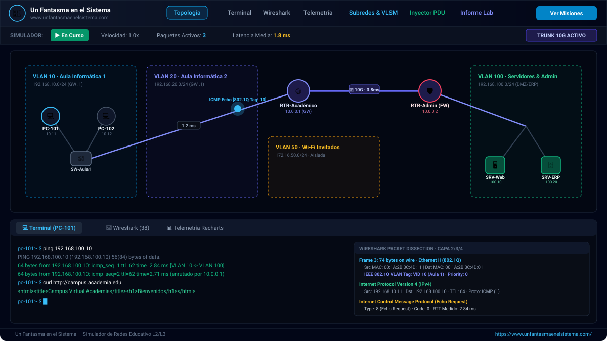
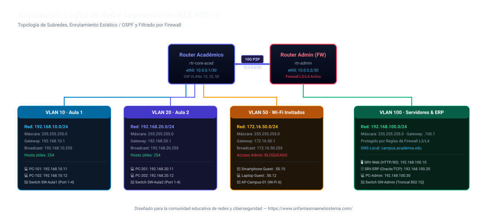

<p align="center">
  <a href="https://www.unfantasmaenelsistema.com/" target="_blank" rel="noopener noreferrer">
    
  </a>
</p>

<h1 align="center">Simulador de Red Academia — L2/L3 &amp; IEEE 802.1Q</h1>

<p align="center">
  <strong>Simulador interactivo, educativo y profesional de topologías de red con visualización de paquetes en tiempo real, terminal de comandos, inspector estilo Wireshark, segmentación VLAN 802.1Q, latencia dinámica y calculadora VLSM.</strong>
</p>

<p align="center">
  Desarrollado y mantenido por <a href="https://www.unfantasmaenelsistema.com/"><strong>Un Fantasma en el Sistema</strong></a>
</p>

<p align="center">
  
  
  
  
  
</p>

---

## 📸 Capturas de Pantalla y Vista Previa

### 1. Interfaz Principal: Topología Interactiva y Consola de Comandos


### 2. Arquitectura de Red y Segmentación de Subredes


---

## 🌟 Características Destacadas

### 🌐 1. Topología de Red SVG Interactiva y Dinámica
- Visualización de equipos de campus: Routers L3, Switches L2 gestionables, Servidores (Web/DNS/ERP), Estaciones de trabajo (PCs), Dispositivos móviles y Puntos de Acceso Wi-Fi 6.
- **Animación física de paquetes**: Las tramas viajan de nodo a nodo con velocidad normalizada y color según el protocolo.
- **Latencia Fluctuante y Encolamiento**: Cada enlace muestra su retardo real en milisegundos (`ms`), que fluctúa dinámicamente según la congestión de la subred y jitter aleatorio.
- **Simulador de Fallos y Cortes Físicos (*Link Fault Simulation*)**: Haz clic en cualquier cable o enlace troncal para desconectarlo (`LINK DOWN`) y observa cómo los paquetes se descartan físicamente con explicaciones didácticas en tiempo real.

### 💻 2. Consola de Terminal Interactiva
Soporta comandos de red reales con historial, autocompletado y atajos rápidos:
- `ping <ip|host>` — Envío de paquetes ICMP Echo Request y cálculo del RTT fluctuante.
- `traceroute <ip|host>` — Trazado salto a salto con decrecimiento de TTL en routers.
- `arp -a` y `arp -d` — Inspección y vaciado de la caché dinámica de resolución ARP.
- `ipconfig` / `ifconfig` — Desglose de interfaces de red, IPs, máscaras, gateways y MACs.
- `curl <url>` — Peticiones HTTP reales al servidor del campus (`campus.academia.edu`).
- `nslookup <dominio>` — Consulta al servidor DNS interno.
- `mac-table` — Consulta de la tabla CAM del switch local con mapeo de puertos y VLANs IEEE 802.1Q.
- `show vlan` / `vlan set <puerto> <id>` — Configuración interactiva de puertos de acceso y troncales.
- `web` / `about` — Información del proyecto y enlace directo a [Un Fantasma en el Sistema](https://www.unfantasmaenelsistema.com/).
- `clear` y `help` — Ayuda contextual y limpieza de pantalla.

### 🦈 3. Inspector de Paquetes (Estilo Wireshark)
- Captura pasiva y activa de todo el tráfico del campus (ICMP, ARP, DNS, HTTP, TCP).
- **Disección por capas (Modelo OSI / TCP-IP)**:
  - **Capa 2 (Enlace)**: Cabecera Ethernet II (MAC origen/destino, EtherType) y **etiquetado IEEE 802.1Q (VID, TPID 0x8100, Prioridad PCP)**.
  - **Capa 3 (Red)**: Cabecera IPv4 (IP origen/destino, TTL, número de protocolo).
  - **Capa 4 (Transporte)**: Puertos TCP/UDP, flags SYN/ACK, tipos y códigos ICMP.
  - **Capa 7 (Aplicación)**: Mensajes HTTP, peticiones DNS y payloads didácticos.
- Botón **"Resaltar Camino en la Topología"** para trazar visualmente la ruta completa que siguió el paquete.

### 🧮 4. Herramienta de Subredes & Calculadora VLSM / CIDR
- **Mapa de Subredes del Campus**: Detalle de cada subred (VLAN 10, VLAN 20, VLAN 50 Wi-Fi Invitados, VLAN 100 Administración y Enlace Troncal L3 `/30`).
- **Calculadora Interactiva**:
  - Slider de prefijo CIDR de `/8` a `/30`.
  - Cálculo instantáneo de Dirección de Red, Máscara Decimal, Máscara Wildcard (OSPF/Cisco ACLs), Rango de Hosts Útiles, Dirección de Broadcast y ámbito RFC 1918.
  - **Desglose Binario Educativo de 32 Bits**: Visualización de los 4 octetos con diferenciación de color entre **bits de red** y **bits de host**.

### 🚀 5. Inyector Didáctico de Paquetes PDU (*Packet Crafter*)
- Diseña tramas personalizadas al estilo Cisco Packet Tracer.
- Ajuste del campo **TTL (Time To Live)** de 1 a 64: experimenta cómo un TTL bajo caduca en los routers intermedios generando mensajes *ICMP Time Exceeded*.

### 📊 6. Telemetría de Tráfico en Tiempo Real (Recharts)
- Gráficos de series temporales de ancho de banda por subred (Aulas, Invitados, Admin y Errores).
- Configuración de umbrales de alerta con cambio de color automático ante sobrecargas.

### 🛡️ 7. Editor de Listas de Control de Acceso (ACLs) en Routers
- **Filtrado Avanzado L3/L4**: Configura reglas explícitas de **PERMIT** o **DENY** basadas en rangos de IP, máscaras CIDR, puertos destino/origen (ej. HTTP 80, HTTPS 443, DNS 53, BD 1521) y protocolos (`TCP`, `UDP`, `ICMP`, `ANY`).
- **Principio First-Match en Tiempo Real**: Reordena la prioridad de las reglas con botones de subida/bajada (▲ y ▼); el motor de enrutamiento evalúa secuencialmente de arriba hacia abajo y descarta los paquetes denegados en el router exacto con retroalimentación visual y auditiva.
- **Probador Interactivo de Coincidencias (*ACL Engine Sandbox*)**: Simula en vivo cualquier combinación de equipo origen, destino, protocolo y puerto para comprobar al instante qué regla se aplica y por qué.
- **Generador de Configuración Cisco IOS CLI**: Exporta las reglas a sintaxis real de Cisco (`access-list extended 101/102`, `ip access-group in/out`) con cálculo automático de máscaras *Wildcard* para su uso en laboratorios CCNA.
- **Plantillas de Seguridad Predefinidas**: Aplica con un clic escenarios educativos como *Aislamiento Estricto de Wi-Fi Invitados*, *Protección de Base de Datos de Secretaría* o *Bloqueo de Ping ICMP entre Aulas*.

### 💾 8. Exportación y Carga de Laboratorios Personalizados (JSON)
- **Exportar Configuración (.json)**: Guarda en cualquier momento el estado completo de la red (nodos, enlaces, interfaces, tablas ARP/CAM y reglas de firewall) en un archivo `.json` estructurado y descargable con un solo clic o mediante el comando `export` en la terminal.
- **Cargar Laboratorio (.json)**: Importa y valida topologías creadas previamente para continuar prácticas, compartir escenarios con alumnos o evaluar configuraciones.

### 🔊 9. Efectos de Audio Sintetizados (Web Audio API)
- Retroalimentación auditiva sin dependencias externas: sonido de salto de paquete (*hop*), entrega exitosa, alerta de descarte por firewall y fanfarria al completar misiones.

---

## 🗺️ Mapa de Direccionamiento de la Red

| Subred / Zona | VLAN | Prefijo CIDR | Máscara de Subred | Gateway | Rango Útil | Propósito |
| :--- | :---: | :---: | :---: | :---: | :---: | :--- |
| **Aula Informática 1** | 10 | `192.168.10.0/24` | `255.255.255.0` | `192.168.10.1` | `.10.1` - `.10.254` | Estaciones PC-101, PC-102 |
| **Aula Informática 2** | 20 | `192.168.20.0/24` | `255.255.255.0` | `192.168.20.1` | `.20.1` - `.20.254` | Estaciones PC-201, PC-202 |
| **Wi-Fi Invitados** | 50 | `172.16.50.0/24` | `255.255.255.0` | `172.16.50.1` | `.50.1` - `.50.254` | Móviles y portátiles (aislado) |
| **Admin & Servidores** | 100 | `192.168.100.0/24` | `255.255.255.0` | `192.168.100.1` | `.100.1` - `.100.254` | Web, DNS, ERP, PC-Admin |
| **Troncal Inter-Router** | 1 | `10.0.0.0/30` | `255.255.255.252` | N/A (P2P) | `10.0.0.1` - `10.0.0.2` | Enlace 10G entre Core Routers |

---

## 🚀 Instalación y Puesta en Marcha

### Prerrequisitos
- [Node.js](https://nodejs.org/) (versión 18 o superior recomendada)
- `npm` o `bun`

### Clonar el Repositorio
```bash
git clone https://github.com/tu-usuario/simulador-redes-academia.git
cd simulador-redes-academia
```

### Instalar Dependencias
```bash
npm install
```

### Iniciar el Servidor de Desarrollo
```bash
npm run dev
```
Abre en tu navegador: [http://localhost:3000](http://localhost:3000)

### Compilar para Producción
```bash
npm run build
```
Los archivos optimizados para producción se generarán en el directorio `dist/`.

---

## 📁 Estructura del Proyecto

```text
├── docs/
│   └── images/                     # Capturas y diagramas de arquitectura en SVG
├── public/
│   └── assets/aistudio/            # Logotipo oficial "Un Fantasma en el Sistema"
├── src/
│   ├── components/
│   │   ├── DeviceDetailModal.tsx   # Inspector de tarjetas de red, ARP y CAM
│   │   ├── LabMissionsModal.tsx    # Misiones guiadas de aprendizaje
│   │   ├── LabReportModal.tsx      # Generador de informes de laboratorio (.md)
│   │   ├── NetworkSummaryBar.tsx   # Controles de reproducción y métricas globales
│   │   ├── NetworkTelemetryDashboard.tsx # Gráficas en tiempo real con Recharts
│   │   ├── NetworkTopologyCanvas.tsx     # Lienzo SVG interactivo con fallo de enlaces
│   │   ├── PacketBuilderModal.tsx  # Inyector de tramas PDU y pruebas de TTL
│   │   ├── SubnetCalculatorModal.tsx     # Calculadora VLSM y desglose binario
│   │   ├── TerminalConsole.tsx     # Emulador de consola terminal de red
│   │   ├── TopNav.tsx              # Barra de navegación principal y controles de audio
│   │   └── WiresharkInspector.tsx  # Disección de paquetes en 5 capas OSI
│   ├── data/
│   │   └── topologyData.ts         # Definición de nodos, enlaces, VLANs y misiones
│   ├── services/
│   │   └── networkEngine.ts        # Motor de simulación L2/L3, latencias y enrutamiento
│   ├── types/
│   │   └── network.ts              # Interfaces TypeScript (nodos, tramas, paquetes)
│   ├── utils/
│   │   └── audioEffects.ts         # Sintetizador Web Audio API nativo
│   ├── App.tsx                     # Componente principal y gestión de estado
│   └── main.tsx                    # Punto de entrada React
├── index.html                      # HTML con favicon oficial y metaetiquetas
├── package.json                    # Dependencias y scripts
├── tsconfig.json                   # Configuración de TypeScript
└── vite.config.ts                  # Configuración de Vite y Tailwind CSS
```

---

## 🤝 Misiones Educativas Guiadas

El simulador incluye 7 misiones guiadas con autoevaluación:
1. **Misión 1**: Comunicación Local y Resolución ARP (conmutación en misma VLAN).
2. **Misión 2**: Enrutamiento Inter-VLAN y Salto de Router (Gateway predeterminado).
3. **Misión 3**: Seguridad Perimetral y Reglas de Firewall L3/L4.
4. **Misión 4**: Resolución de Nombres de Dominio (DNS) y Acceso Web (HTTP).
5. **Misión 5**: Trazado de Rutas (*Traceroute*) y Expiración de Saltos TTL.
6. **Misión 6**: Segmentación Lógica IEEE 802.1Q en Switches y Tablas CAM.
7. **Misión 7**: Latencia Fluctuante y Encolamiento por Carga de Subred.

---

## 👤 Autor y Agradecimientos

Creado por **Un Fantasma en el Sistema**:
- 🌐 Sitio Web Oficial: [https://www.unfantasmaenelsistema.com/](https://www.unfantasmaenelsistema.com/)
- 📖 Artículos, tutoriales y recursos prácticos sobre redes, ciberseguridad, hacking ético y sistemas.

---

## 📄 Licencia

Este proyecto está bajo la Licencia [MIT](LICENSE) — siéntete libre de utilizarlo para fines educativos, académicos o personales.
